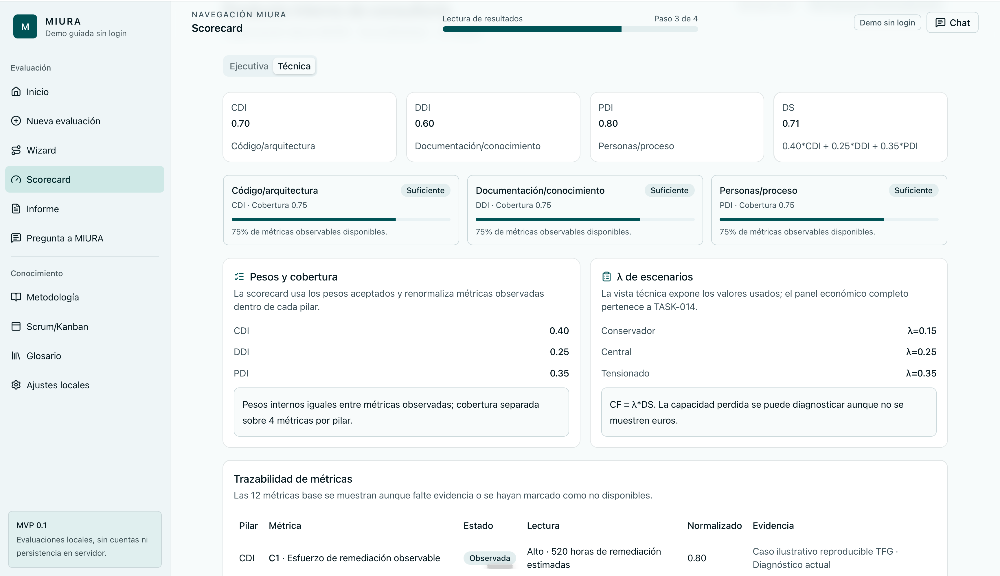
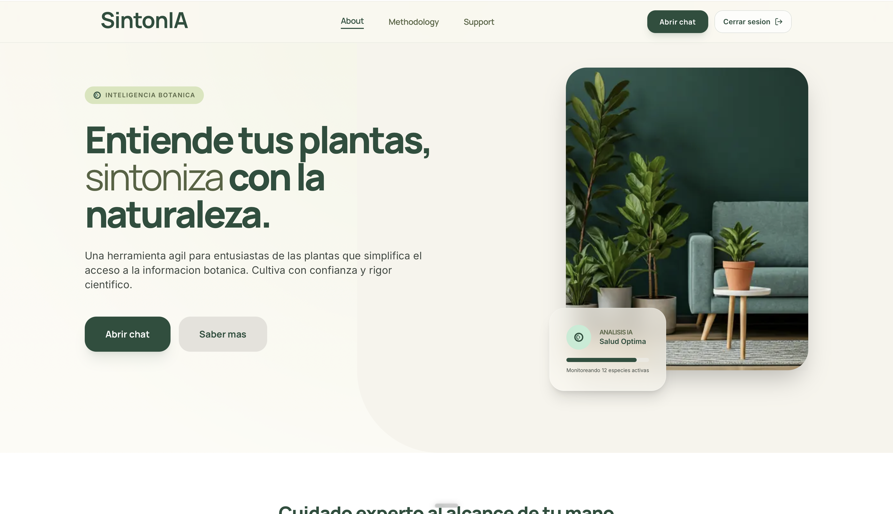

# Carlota Moreno García ✨

**Technical Project Delivery · Product & Software Coordination · AI Applications**

I’m a software engineer with experience in project delivery, product coordination and software development.

My background combines business understanding, technical execution and cross-functional coordination. I’m especially interested in digital products, AI applications and technology projects where delivery, prioritisation and stakeholder alignment matter.

## Featured Projects

### MIURA — Technical Debt & Decision Support

Academic framework and interactive application for assessing technical debt and exploring prioritisation scenarios.  
This project combines software engineering, decision-making and business-oriented analysis through an MVP designed to support technical and strategic conversations.

[View repository](https://github.com/carlotamoreeno/MIURA-WEB)

---

### SintonIA — Document-based AI Assistant

Document-grounded AI assistant designed to answer questions with source-based responses.  
The project focuses on knowledge organisation, conversational interaction and traceability of information through a structured and versioned document environment.

[View repository](https://github.com/carlotamoreeno/SintonIA)
